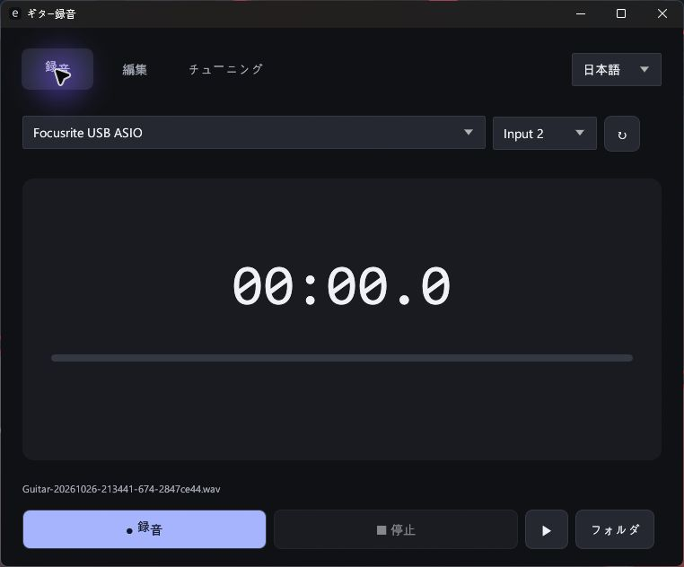

# ギター録音

**無料のWindows用ギターチューナー・録音・簡易編集アプリ。**

**[Windows x64版をダウンロード](https://github.com/ApexLegendIsFun/guitar-recorder/releases/latest)**

[한국어](README.ko.md) · [English](README.md)

- ギター入力をモノラル24ビットPCM WAVで録音。サンプルレートは機器の現在の設定を使用。
- 標準6弦 E2/A2/D3/G3/B3/E4のチューナー。A4=440Hz、セントと締める・緩める方向を表示。
- WAVを開き、範囲選択・試聴・無劣化の切り出し。元ファイルは保持。
- 保存した録音やクリップをファイルとしてコピー。対応するチャットアプリにCtrl+Vで貼り付け。
- 右上で韓国語・英語・日本語に切り替え。選択した言語は次回も保持。

ダークテーマ。インストール・.NET・アカウント・広告・課金・ネットワーク通信は不要。録音はPC内に保存。

## 使い方

1. ReleaseからZIPをダウンロードして展開し、`GuitarRecorder.exe`を起動。
2. ギターをFocusriteのInput 2に接続してINSTを有効にし、ヘッドホンもFocusriteに接続。
3. 機器のDirect Monitorを有効にする。アプリは入力音をリアルタイムで出力しない。
4. 録音 → 停止。ミュージック内の`Guitar Recorder`に自動保存。
5. チューニングで1本ずつ弾く。編集 → 開くで録音を選び、範囲を指定して切り出す。

Windows 10/11 x64、OpenGL 3.3対応グラフィックスドライバー、Focusrite ASIOドライバーが必要。
検証機器はScarlett Solo / Focusrite USB ASIO、44.1kHz。現在の再生先はFocusrite出力。
内蔵マイクや他のASIO機器の動作は保証しない。編集はモノラル24ビットPCM WAVに対応。
クリップは元ファイルと同じフォルダに別名で保存。貼り付けの可否は対象アプリに依存し、自動送信はしない。

実行ファイルはコード署名されていない。SHA256はReleaseに掲載。
このリポジトリでは無料の実行ファイルとドキュメントのみを公開。アプリのソースコードは非公開。
第三者ソフトウェアのライセンスはZIPに同梱。
