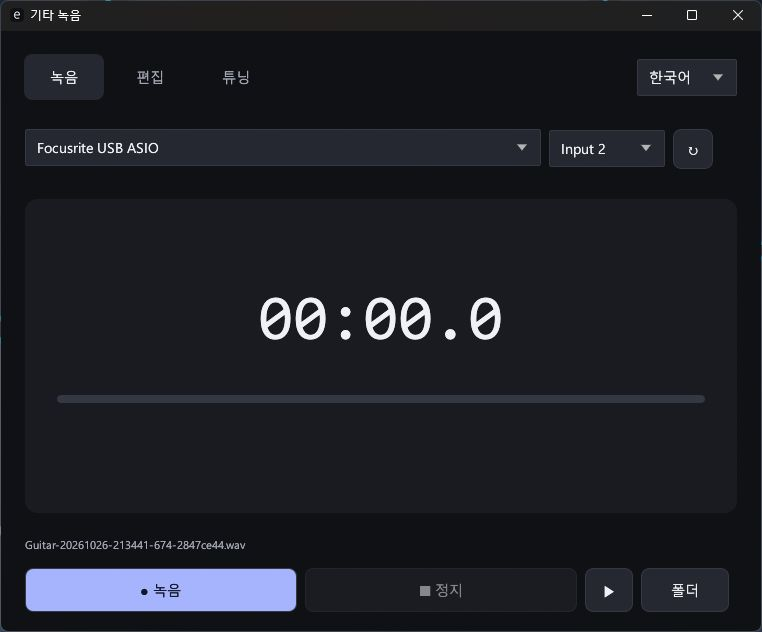

# 기타 녹음

**무료 Windows 기타 튜너·녹음·간단 편집 앱.**

**[Windows x64 다운로드](https://github.com/ApexLegendIsFun/guitar-recorder/releases/latest)**

[English](README.md) · [日本語](README.ja.md)

- 기타 입력 하나를 모노 24비트 PCM WAV로 녹음. 샘플레이트는 장비 현재 설정 유지.
- 표준 6현 E2/A2/D3/G3/B3/E4 튜너. A4=440Hz, 센트·조임·풀림 안내.
- WAV 열기, 구간 선택·미리듣기·무손실 자르기. 원본은 보존.
- 저장하면 파일 복사. 파일 첨부를 지원하는 채팅창에서 Ctrl+V로 공유.
- 오른쪽 위에서 한국어·영어·일본어 전환. 선택한 언어는 다음 실행에도 유지.

다크테마. 설치·.NET·계정·광고·결제·네트워크 통신 없음. 녹음은 PC에 저장.

## 실행

1. Release의 ZIP을 풀고 `GuitarRecorder.exe` 실행.
2. Focusrite Input 2에 기타 연결, INST 켜기. 헤드폰도 Focusrite에 연결.
3. Direct Monitor 켜기. 앱은 실시간 입력을 다시 출력하지 않음.
4. 녹음 → 정지. 음악 폴더의 `Guitar Recorder`에 자동 저장.
5. 튜닝에서 한 줄씩 뜯기. 편집 → 열기로 녹음 선택, 구간 지정 → 잘라서 복사.

Windows 10/11 x64, OpenGL 3.3 그래픽 드라이버, Focusrite ASIO 드라이버 필요.
검증 장비는 Scarlett Solo / Focusrite USB ASIO, 44.1kHz. 현재 재생은 Focusrite 출력 사용.
내장 마이크·다른 ASIO 장비는 동작 보장 없음. 편집은 모노 24비트 PCM WAV만 지원.
클립은 원본 옆에 별도 저장. 클립보드 파일 붙여넣기는 대상 앱 지원 여부에 따라 다르며 자동 전송하지 않음.

실행 파일은 코드 서명되지 않았으며 Release에서 SHA256 확인 가능.
이 저장소는 무료 실행 파일과 문서만 공개. 앱 소스는 비공개이며, 제3자 라이선스는 ZIP에 포함.
