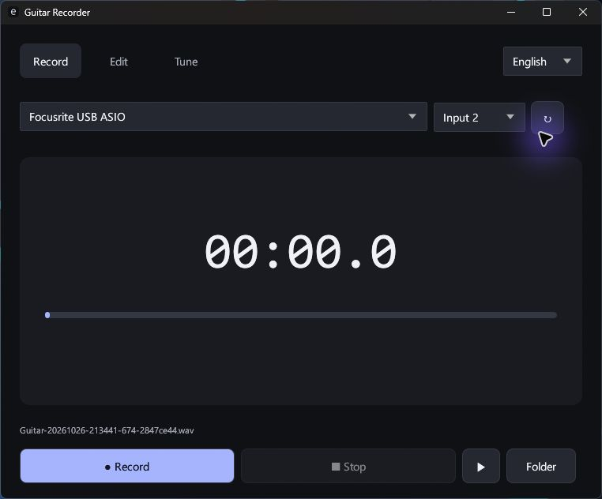

# Guitar Recorder

**Free guitar tuner, recorder and clip editor for Windows.**

한국어 · English · 日本語

**[Download for Windows x64](https://github.com/ApexLegendIsFun/guitar-recorder/releases/latest)**

[한국어 안내](README.ko.md) · [日本語ガイド](README.ja.md)

## What it does

- Record a single guitar input as a mono **24-bit PCM WAV**, at your interface's current sample rate.
- Tune standard guitar strings **E2 · A2 · D3 · G3 · B3 · E4**, with pitch, cents and tighten/loosen guidance. A4 = 440 Hz.
- Open a WAV, select a range, preview it and save a separate lossless clip. The original stays intact.
- Copy a saved recording or clip as a file, then paste it into a chat app that supports file attachments.
- Switch between **Korean, English and Japanese** from the top right. The choice is remembered.

Dark theme. Portable Rust executable. No installer, .NET, account, ads, subscription or network requests.

## Requirements

**Windows 10/11 x64**, an **OpenGL 3.3** graphics driver and a **Focusrite interface with the Focusrite ASIO driver**.

Tested with Scarlett Solo / Focusrite USB ASIO at 44.1 kHz. Playback currently uses the Focusrite output. Built-in microphones and other ASIO interfaces are not guaranteed to work. The executable is unsigned; SHA256 checksums accompany each release.

## Quick start

1. Download the ZIP from Releases, extract it and run `GuitarRecorder.exe`.
2. Plug your guitar into **Input 2**, enable **INST**, and connect headphones to Focusrite.
3. Enable the interface's **Direct Monitor** to hear yourself. The app does not route live input to speakers.
4. Use **Record → Stop**. Files save automatically in your Windows **Music / Guitar Recorder** folder.
5. Use **Tune** and pluck one string at a time. Use **Edit → Open** to choose an existing recording.

The editor accepts **mono 24-bit PCM WAV** only. Cuts are separate files beside the source. Clipboard copy does not send or upload anything. Which chat apps accept pasted files depends on the destination app.

This repository distributes **free application downloads and documentation only**. Application source code is not published here. Third-party notices are included in the ZIP.
